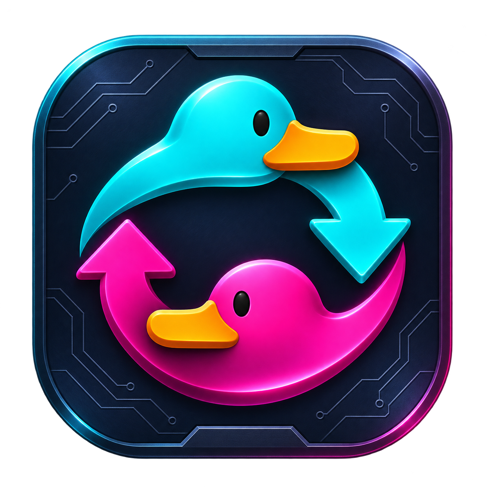

<p align="center"></p>

# Technoduck

A native macOS file-transfer client written in Swift and SwiftUI, with a local folder and a server folder side by side.

**Protocols:** SFTP, FTP, FTPS, WebDAV (HTTP/HTTPS) and local disk.

## Features

- **Dual pane:** your Mac on the left (A), the server on the right (B). Use the arrows to copy the selection across, or drop files from Finder onto the server pane.
- **Sync:** A → B, B → A, or both ways (newest wins). A **Dry Run** compares only and lists every file that would be copied, with totals per direction.
- **Undo:** files that get replaced are backed up first, so any sync or copy can be rolled back from the Transfers or Timeline panel. A sync never deletes anything.
- **Timeline per connection:** uploads, downloads, syncs, deletes and undos, grouped by day.
- **Folder sizes:** every folder's total size is worked out in the background.
- **Hidden files:** View › Show Hidden Files (⇧⌘.).
- **Excludes:** per bookmark, e.g. `node_modules, .git, *.log`.
- **Folder pairs and auto-upload:** each bookmark remembers its local and server folders, and can upload changes as soon as you save.
- **Edit in your own app:** open a server file in its default app; every save is uploaded back to the server.

Passwords are stored in the macOS Keychain. SFTP uses the system `sftp` (your SSH keys work), and FTP/FTPS use the system `curl`.

## Build

Requires macOS 14 or later and Swift 5.9 or later.

```sh
./build-app.sh                       # builds Technoduck.app
.build/release/Technoduck --self-test
```

`Cargo.toml` and `launcher/` only exist so a Cargo-based checker can build and start the Swift app. You don't need them.
